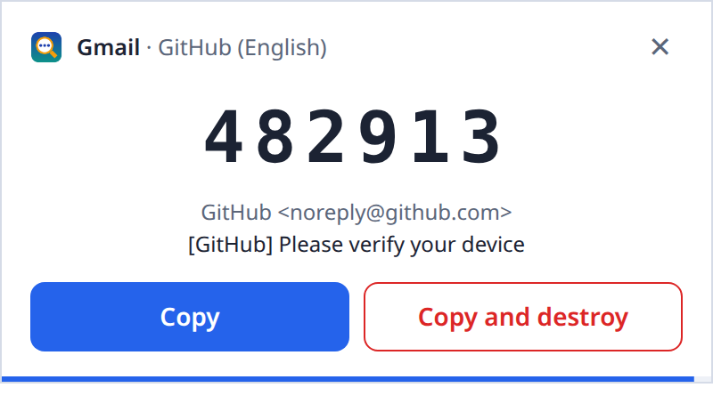
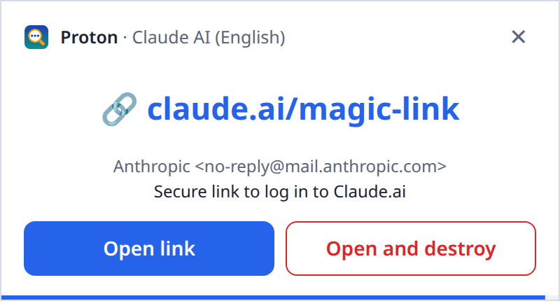
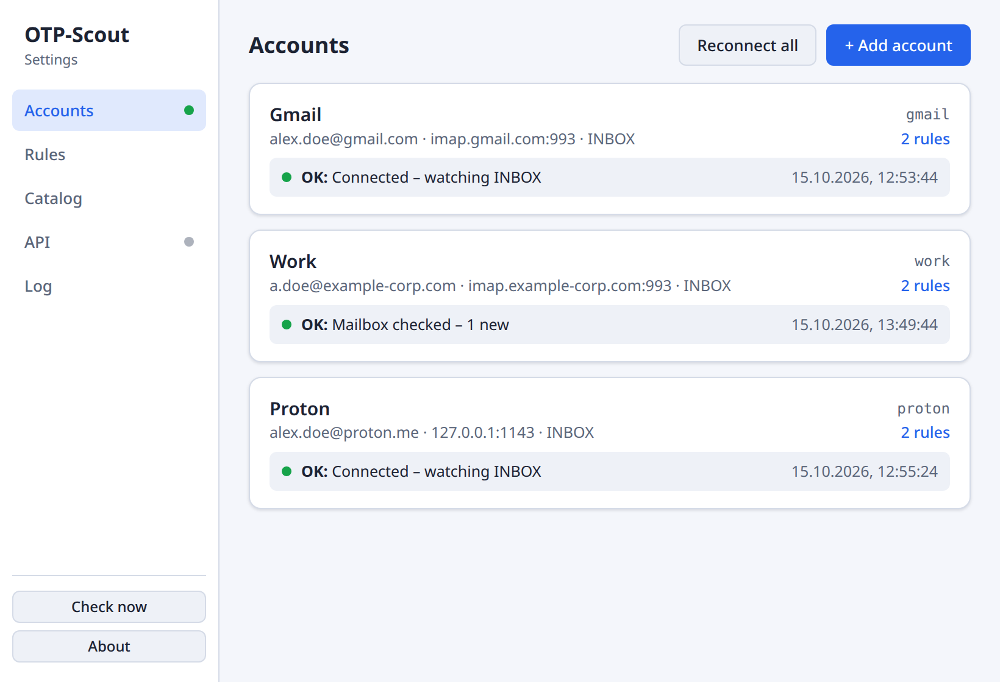
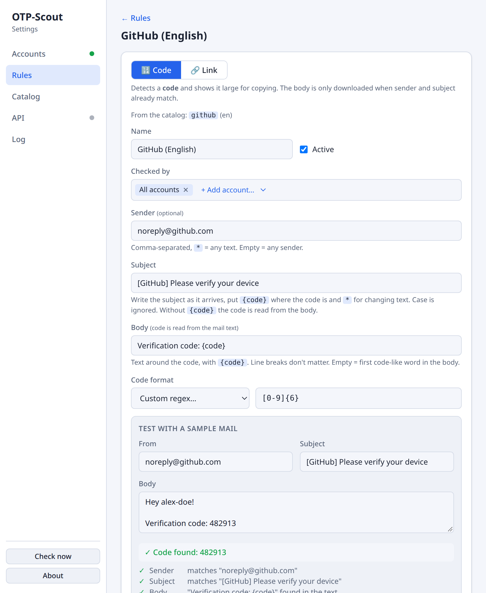
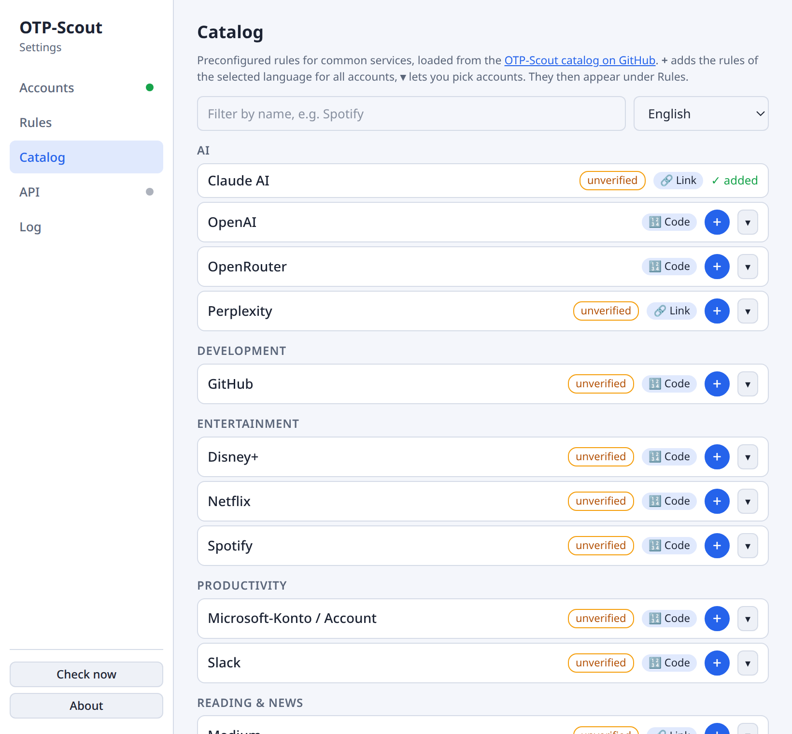

# OTP-Scout

*your one-time password helper* · a tray app for Linux

**OTP-Scout watches your mailboxes and pops up one-time passwords and magic login links the moment they arrive. Copy the code or open the link with one click, without opening your mail client.**

<p align="center">
  <picture>
    <source media="(prefers-color-scheme: dark)" srcset="docs/images/popup-code-dark.png">
    
  </picture>
</p>

You log in somewhere and the site sends you a code by email. Instead of switching to your mail program, waiting, searching and copying, the code appears in the middle of your screen. One click and it's in your clipboard.

## Who It's For

- You log in **many times a day** with codes sent by mail: shops, streaming, AI tools, work portals.
- You work with **several mailboxes**, e.g. private, work and test accounts, and don't want to check each one.
- Your services offer **no authenticator app**, only email codes or magic links.

## What It Does for You

- **Codes appear instantly.** The mail server tells OTP-Scout about new mail right away (IMAP IDLE), with no polling.
- **One click to copy.** Click the code or press Enter, then paste it wherever you need it.
- **Login links, too.** Some services, such as Claude, send a link instead of a code. OTP-Scout recognizes it and opens it in your browser with one click.

  <picture>
    <source media="(prefers-color-scheme: dark)" srcset="docs/images/popup-link-dark.png">
    
  </picture>
- **Keep your inbox clean.** *Copy and destroy* copies the code and deletes the email in one go.
- **All your mailboxes.** Gmail, iCloud, GMX, your company account, Proton Mail via the Bridge. Add as many as you like.
- **Ready-made rules.** Pick common services from the built-in catalog, or describe the email yourself and test the rule with a sample right away.
- **Out of your way.** It lives quietly in the system tray and only shows up when there is something for you.

## A Look at the Settings

| Accounts | Rules with live test | Catalog |
|---|---|---|
| <picture><source media="(prefers-color-scheme: dark)" srcset="docs/images/accounts-dark.png"></picture> | <picture><source media="(prefers-color-scheme: dark)" srcset="docs/images/rule-editor-dark.png"></picture> | <picture><source media="(prefers-color-scheme: dark)" srcset="docs/images/catalog-dark.png"></picture> |
| Connect your mailboxes and see their status at a glance. | Describe the mail; the test box shows step by step whether the code is found. | Add rules for common services with one click. |

## Install

For Ubuntu 22.04+, Linux Mint 21+ and Debian 12+:

1. Download the `.deb` file from the [latest release](https://github.com/Skrrytch/otp-scout/releases/latest).
2. Install it by double-clicking it, or in a terminal:
   ```bash
   sudo apt install ./otp-scout_*_amd64.deb
   ```
3. Start **OTP-Scout** from your application menu. A magnifying-glass icon appears in the system tray.

To uninstall: `sudo apt remove otp-scout`. Your settings in `~/.config/otp-scout/` are kept.

## Quick Start

1. Click the tray icon and choose **Settings**.
2. Under **Accounts**, click **+ Add account** and enter your mail server, username and password. **Test connection** checks them before you save. For Gmail, Proton Mail and others, see [Setting up accounts](docs/accounts.md).
3. Under **Catalog**, click **+** next to the services you use. Or create your own rule under **Rules**, see [Rules](docs/rules.md).
4. Send yourself a test: an email with the subject `123456 is your verification code` pops up right away.

## Everyday Use

- **Popup:** Enter or a click copies the code, Esc dismisses it. Several codes at once are stacked, and each disappears after two minutes. Hovering over the popup pauses the countdown.
- **Tray menu:** *Check now* checks all mailboxes immediately. The menu also opens *Settings* and *About*, and *Quit* ends OTP-Scout.
- **Connection problems** show up on the account card and as a desktop notification. OTP-Scout reconnects on its own.
- **No popup for a mail?** The *Log* tab shows every checked mail and why each rule did or didn't match. See [Why wasn't a code detected?](docs/rules.md#why-wasnt-a-code-detected)

## Privacy & Security

- **Everything stays on your computer.** OTP-Scout talks only to your mail servers. The only other request loads the rule catalog from GitHub.
- **It reads as little as possible.** Only sender and subject of new mails are fetched. The mail text is downloaded only when a rule needs it. Nothing is marked as read.
- **Nothing is written to disk.** Codes and mail text aren't stored. The *Log* tab keeps sender, subject and rule results in memory only, with codes masked.
- **Your passwords stay safe.** They're kept in the system keyring (GNOME Keyring, KWallet), never in a plain text file.

## Documentation

- [Setting up accounts](docs/accounts.md): IMAP settings for common providers, Proton Mail Bridge, connection problems
- [Rules](docs/rules.md): code and link rules, patterns, catalog, sharing rules, why a code wasn't detected
- [Codes from your browser](docs/api.md): the local HTTP API for Tampermonkey and other scripts
- [Configuration files](docs/configuration.md): where settings, rules and passwords are stored
- [Development](DEVELOPMENT.md): building from source, tests, releases, architecture
- [Rule catalog](catalog/README.md): format and how to contribute

## License

[MIT](LICENSE) © 2026 Bert Speckels
