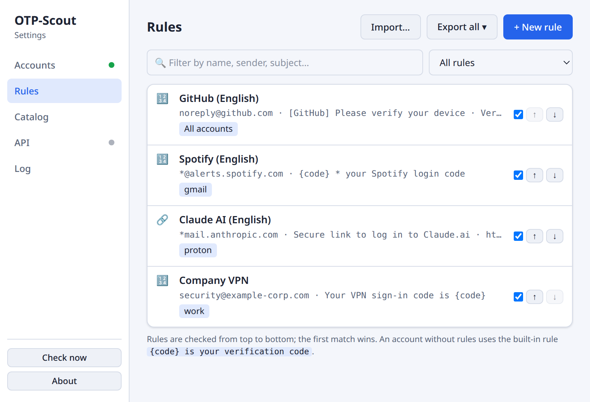
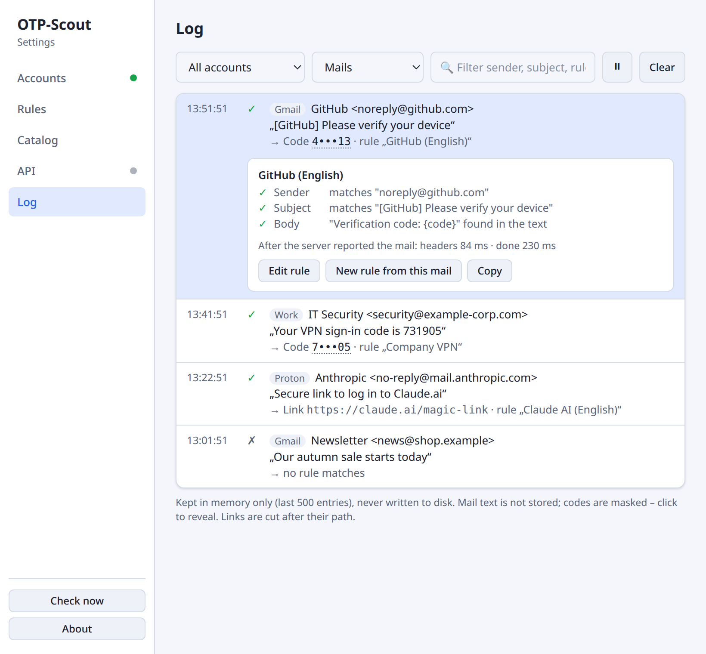

# Rules

A rule tells OTP-Scout what a login mail looks like and where the code or link is. Out of the box, OTP-Scout recognizes mails whose subject reads like *"123456 is your verification code"*. For other services, take ready-made rules from the [catalog](#catalog) or write your own.

<picture>
  <source media="(prefers-color-scheme: dark)" srcset="images/rules-dark.png">
  
</picture>

## How Rules Are Checked

1. For each new mail, OTP-Scout first fetches only **sender and subject**.
2. The rules are checked **from top to bottom**. The first rule that finds a code or link wins. Reorder rules with ↑ and ↓.
3. The mail text is downloaded only if a rule's sender and subject match and the code isn't in the subject.

Changes to rules take effect with the next mail, without reconnecting. Unchecking a rule in the list turns it off without deleting it.

### Which accounts check a rule

Under **Checked by**, each rule lists the accounts that check it:

- **All accounts**, the default, includes accounts you add later.
- **Single accounts**, e.g. only *Work*. A rule for your work mailbox then doesn't fire on your private mail.

The list shows these as account [tags](accounts.md#tag). A rule without any account isn't checked and is marked with ⚠. An account that checks no rule at all uses the built-in rule `{code} is your verification code`.

## Writing a Rule

<picture>
  <source media="(prefers-color-scheme: dark)" srcset="images/rule-editor-dark.png">
  
</picture>

Choose **Code** or **Link** at the top, then fill in:

| Field | Meaning |
|---|---|
| **Name** | Shown in the popup and the log. Must be unique, since it identifies the rule when [sharing](#sharing-rules). |
| **Sender** | Optional. One or more sender addresses, separated by commas. `*` matches any text: `noreply@github.com`, `*@alerts.spotify.com`, `*@paypal.de, *@paypal.com`. Empty = any sender. |
| **Subject** | The subject as it arrives, see [patterns](#patterns). Empty = any subject; then set a sender. |
| **Body** | Code rules only, if the subject doesn't contain the code: the text around the code, e.g. `Verification code: {code}`. Empty = the first word in the mail text that looks like a code. |
| **Code format** | Code rules only: what a code looks like. *Digits (4–8)*, *Letters, digits, dash* or a custom regular expression such as `[0-9]{6}`. |
| **Link starts with** | Link rules only: the first link in the mail starting with this text is offered, e.g. `https://claude.ai/magic-link`. |

### Patterns

Subject and body are written the way the text appears in the mail:

| You enter | Matches |
|---|---|
| `{code} is your code` | *482913 is your code* |
| `Your * login code: {code}` | *Your GitHub login code: 482913* |
| `{code} * your Spotify login code` | *913088 – your Spotify login code* |
| `Secure link to log in*` | *Secure link to log in to Claude.ai* |

- `{code}` marks where the code is. It may appear at most once.
- `*` matches any text.
- Any whitespace matches any run of whitespace, including line breaks and non-breaking spaces.
- Upper and lower case don't matter.
- The pattern only has to appear *somewhere* in the subject, so a prefix or a suffix such as a timestamp needs no `*`.
- Everything else is matched literally. Characters like `.`, `+`, `(` or `[` need no escaping.

**Keep the code format specific.** With an empty body pattern, a loose format may pick up a year, a postal code or a word instead of the code. `[0-9]{6}` is safer than *Digits (4–8)* if the service always sends six digits.

### Link rules

For services that send a login link instead of a code. Enter sender and/or subject, and how the link starts. Be specific and include domain and path: only links starting exactly like this are ever offered. OTP-Scout only opens `http(s)://` links.

### Test before you save

The test box in the editor takes a sample sender, subject and mail text. It shows immediately whether the code or link is found, or at which step the rule fails: sender, subject or body. The quickest way to a working rule is to copy a real mail into it.

## Catalog

**Settings → Catalog** offers rules for common services, grouped by category and language. **+** adds the rules of the selected language for all accounts. **▾** lets you pick accounts first. Added rules appear under **Rules** and can be edited freely.

<picture>
  <source media="(prefers-color-scheme: dark)" srcset="images/catalog-dark.png">
  
</picture>

The catalog is loaded from [GitHub](../catalog/README.md) each time you open it, so new services arrive without an app update. Without a connection, the last downloaded catalog is shown. Rules marked **unverified** weren't checked against a real mail yet. Test them before relying on them.

## Sharing Rules

- **Export** in the rule list copies the visible rules as JSON or saves them to a file. Without a filter, that's all rules. With a filter or an account selected, it's exactly the rules shown.
- **Share ▾** in the rule editor does the same for a single rule, including unsaved changes.
- **Import…** reads such a file or pasted JSON and shows a preview before anything changes. Each rule is marked *New*, *Update* (with the changed fields) or *Unchanged*, and can be deselected. You choose which accounts check the new rules.

Rules are **matched by name**; case and surrounding spaces don't matter. An updated rule keeps its accounts, active state and position. Only what it matches changes. Exports contain no account tags and no internal ids.

### Suggesting a rule for the catalog

Tested a rule against a real mail? **Share ▾ → Suggest for the catalog…** asks for the service name and language. It then builds the entry for `catalog.json`. *Copy entry* puts it in the clipboard. *Open GitHub issue…* opens a new issue that already contains it. See the [catalog README](../catalog/README.md) for what belongs in the catalog.

## Why Wasn't a Code Detected?

<picture>
  <source media="(prefers-color-scheme: dark)" srcset="images/log-dark.png">
  
</picture>

**Settings → Log** lists every checked mail with its result:

- ✓ **found:** a rule found a code or link.
- ⚠ **partial:** sender and subject matched, but the code or link wasn't found in the mail text.
- ✗ **no rule matches:** no rule matched sender and subject.

Click an entry to see, per rule, which step matched or failed. From there, **Edit rule** opens the rule, and **New rule from this mail** creates a rule prefilled with sender and subject. The log keeps the last 500 entries in memory only. It never stores mail text, and codes are masked until you click them.

Typical causes:

- **The subject differs slightly**, e.g. a different dash, an extra word, or another language. Use `*` for parts that vary.
- **The sender differs:** many services send from several addresses. Prefer a domain pattern like `*@example.com`.
- **Another rule matched first.** Move the more specific rule up.
- **The mail landed in another folder**, e.g. spam. OTP-Scout watches only the folder set in the account.
- **The rule isn't checked by this account.** Look at **Checked by**.
